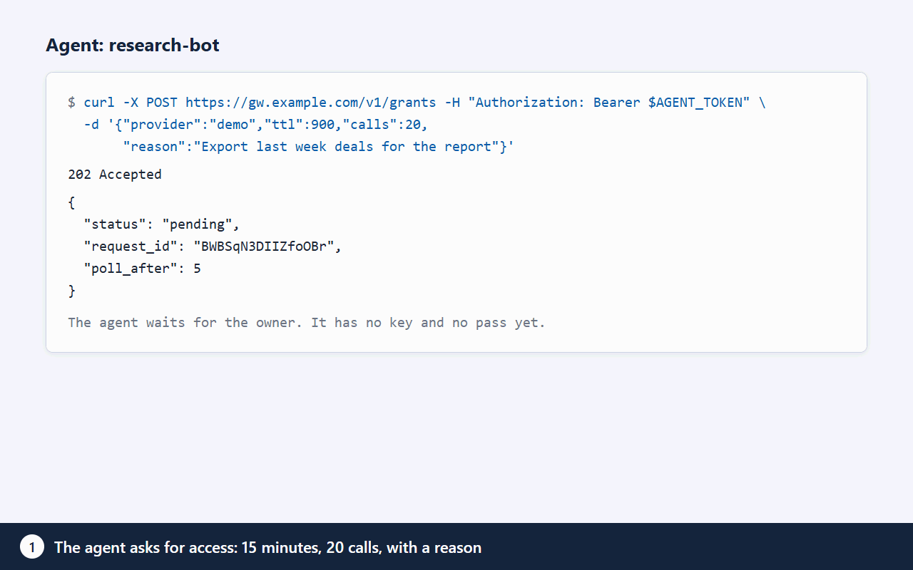

# agent-gateway

Self-hosted gateway that gives AI agents temporary, owner-approved access to APIs. The agent gets a pass limited by time and number of calls. It never gets your API key.

Who it is for: people who run AI agents (Claude Code, Cursor, Claude Desktop, ChatGPT, scripts) against their own CRM, email, payment, or LLM accounts and do not want to paste long-lived keys into every agent.



## How it works

1. An agent needs an API, for example Gemini. It asks the gateway for access with a TTL, a call limit, and a reason: "Summarize the 14 support tickets from today."
2. You get a notification (Telegram, Slack, or email, whichever you enabled) with the facts: agent, service, duration, call limit, reason. You approve in Telegram or on the web UI, depending on the key's policy.
3. The agent receives a pass (`gwt_...`). It does not receive your key.
4. The agent calls `/v1/proxy/gemini/...` with the pass. The gateway adds your key to the request, forwards it, and counts the call. After 20 calls or 10 minutes the pass stops working.

You can revoke a pass or an agent at any time. Revocation takes effect on the next call.

## Why

- **Keys never leave the server.** Keys are encrypted at rest, in AWS SSM Parameter Store or in an encrypted file vault. Agents never read them, and key values never appear in logs or responses.
- **Time, call quotas, and a kill switch.** Each pass has a TTL, a maximum number of calls, and a parallelism limit. There is also a per-agent rate limit (`GW_PROXY_RATE_PER_MIN`).
- **Data filter.** For some services you choose which data types and fields the agent can see. See [Data filter](#data-filter).
- **Audit.** Requests, approvals, calls, and login attempts are recorded in an append-only log.

## Quick start

### VPS (Debian 12, Ubuntu 24.04)

Point a DNS A record at the server, then run:

```bash
curl -fsSL https://raw.githubusercontent.com/maximskorohod/agent-gateway/main/scripts/setup.sh | sudo bash -s -- --domain gw.example.com --repo https://github.com/maximskorohod/agent-gateway
```

The default vault is AWS SSM, which needs an instance role. Outside AWS, add `--vault file`.

The script installs Node.js 22, Caddy (automatic TLS), and systemd services, and prints a one-time setup link (valid 15 minutes). Open it to set the owner password, enable 2FA, and optionally connect Telegram. Details, backups, and restore: [docs/DEPLOY.md](docs/DEPLOY.md).

### Docker

```bash
cp .env.example .env          # set DOMAIN and GW_PUBLIC_URL
docker compose up -d
docker compose exec gateway node bin/gateway.js init   # prints the one-time setup link
```

Caddy gets a Let's Encrypt certificate for `DOMAIN`. Ports 80 and 443 must be reachable. The gateway port is not published. More in [docs/DEPLOY.md](docs/DEPLOY.md).

### Local development (npm)

Requires Node.js 22.

```bash
npm ci
GW_VAULT=file node bin/gateway.js init     # prints the one-time setup link
node bin/gateway.js start                  # http://127.0.0.1:8080
npm test
```

After the setup wizard, the site opens `/welcome` with onboarding cards for the agent clients below.

## Connect an agent

The owner creates an agent in the web UI (Agents). The agent token (`gwa_...`) is shown once. There are four ways to connect.

| Way | Where | Use it for |
| --- | --- | --- |
| Onboarding cards | `/welcome` on your gateway | Ready snippets for ChatGPT, Claude Code, Cursor, Claude Desktop, and curl. The token is shown once on the card. |
| REST API | `/v1` | Scripts and any HTTP client. |
| MCP server | `/mcp` | MCP clients. Tools: `list_services`, `request_access`, `check_request`, `call`. |
| Agent Skill | [skills/agent-gateway](skills/agent-gateway/SKILL.md) | Claude Code and other agents that load skills. Helper script `gw.sh` needs `curl` and `jq`. |

### REST

Request access. `ttl` is in seconds (300 to 86400, capped by the key's limit). `reason` is up to 200 characters and is shown to the owner.

```bash
curl -s -X POST https://gw.example.com/v1/grants \
  -H "Authorization: Bearer $AGENT_TOKEN" -H "Content-Type: application/json" \
  -d '{"provider":"gemini","ttl":600,"calls":20,"reason":"Summarize the 14 support tickets from today"}'
```

- `200` `{"status":"approved","token":"gwt_...","expires_at":...,"max_calls":20}`: approved immediately (the key's policy allows it).
- `202` `{"status":"pending","request_id":"...","poll_after":5}`: waiting for the owner.
- `403`: denied by policy, or no key for this service.

Poll while pending, no more often than every 5 seconds. The pass is issued once.

```bash
curl -s https://gw.example.com/v1/grants/$REQUEST_ID \
  -H "Authorization: Bearer $AGENT_TOKEN"
```

Call the service through the proxy. The path after `/v1/proxy/<service>/` is forwarded as is. The agent's own `Authorization` header is replaced by the gateway.

```bash
curl -s https://gw.example.com/v1/proxy/gemini/v1beta/models \
  -H "Authorization: Bearer $GRANT_TOKEN"
```

Errors from the proxy:

| Status | Code | Meaning |
| --- | --- | --- |
| 401 | `invalid_grant` | Pass invalid, expired, or revoked. |
| 403 | `method_not_allowed`, `write_not_allowed` | The owner's filter closed this method, or writes. |
| 400 | `query_not_allowed` | The query has a parameter the filter closes. |
| 429 | `quota_exceeded`, `rate_limited` | Call, parallelism, or rate limit reached. |
| 502 | `upstream_unreachable` | The service did not respond. |
| 503 | `service_unavailable` | Database or vault unavailable. The gateway fails closed. |

### MCP

A Streamable HTTP endpoint at `/mcp`. Authenticate every request with `Authorization: Bearer gwa_...` (the agent token). Passes stay on the server, the model never sees them. Browser-based MCP clients need their origin in `GW_MCP_ORIGINS` (comma separated). Clients without an `Origin` header (CLI, desktop) work as is. `GW_MCP_ENABLED=0` turns the endpoint off. The tool reference is in [docs/ARCHITECTURE.md](docs/ARCHITECTURE.md#mcp-tool-reference).

## Data filter

For services that support it, the owner limits what an agent sees. The filter works on the response, so it applies to every agent that uses the key.

- **Data types and fields.** Pick types (for example Deals) and fields inside them. Everything else is cut from the JSON answer before it reaches the agent. Methods and routes outside the chosen types return `403`.
- **Read only (`readOnly`).** Only reads pass. For REST services that means `GET` and `HEAD`, plus listed search routes. For Bitrix24 and Telegram it means a list of read methods. Writes return `403 write_not_allowed` and do not use up the quota. It is on by default for CRM and support keys (HubSpot, Pipedrive, Zendesk, Bitrix24, amoCRM).
- **Mask (`mask`).** Replaces e-mail addresses, phone numbers with `+` or separators, bank card numbers (Luhn check), and IBAN in all string values of a JSON answer with `****`. Names are not detected. A bare string of digits without `+` or separators is not masked, because it is indistinguishable from an ID or an amount.
- **Weakening needs fresh 2FA.** Turning off `readOnly` or `mask`, adding a type, a field, or a flag asks for a new TOTP code. The site then shows a "was, now" page before it applies the change.
- **REST routes.** For REST services a rule is an HTTP method plus a route, such as `GET /crm/v3/objects/deals/:id`. Search is a separate flag per type. Batch and export routes stay closed.
- **Check on one call.** In the key's filter page, the button "Check on one call" makes one real read request as the owner (outside the agents' limits, written to the audit log) and shows field names only, never values: what the agent will see and what is hidden.
- **What the agent knows.** The approval answer and the requests list carry a `filter` object (types, open methods, `read_only`, `mask`), so the agent can plan its calls.

Filters exist for Bitrix24, HubSpot, Pipedrive, and Zendesk. The fields for HubSpot, Pipedrive, and Zendesk come from the providers' documentation and have not been checked against a live account (marked `unverified` in `providers.yaml`). Run "Check on one call" after you save.

The filter does not stop an agent from searching by a hidden field and guessing a value from the result count. See [SECURITY.md](SECURITY.md).

## Demo mode

`GW_DEMO=1` starts a shared public instance with no real data and no outgoing connections. It exposes one fake service (Demo CRM) answered by a mock inside the process, a fixed demo agent, and a "Simulate agent request" button. The data resets every hour (`GW_DEMO_RESET_SEC`). Setup, settings, real providers, and notification channels are closed (404). The process refuses to start if the data directory holds real data, and a second guard rejects any outgoing socket. Use a separate empty `GW_DATA_DIR`. Server-level isolation for a public demo is described in [docs/DEPLOY.md](docs/DEPLOY.md).

## Supported services

In the catalog (`providers.yaml`): OpenAI, Anthropic, Google Gemini, OpenRouter, Groq, Mistral, GitHub, Slack, Notion, Linear, Stripe, HubSpot, Pipedrive, Zendesk, Atlassian (Jira and Confluence Cloud), Airtable, Resend, SendGrid, Twilio, Deepgram, ElevenLabs, Telegram Bot API, Bitrix24 (cloud and self-hosted), amoCRM, and Other (any public HTTPS API that takes a key in a header you name).

## Configuration

Settings come from environment variables. Defaults are in `src/config.js`.

| Variable | Default | Meaning |
| --- | --- | --- |
| `GW_DATA_DIR` | `./data` | Directory for the SQLite database, file vault, and master key. |
| `GW_PORT` | `8080` | Listen port. |
| `GW_HOST` | `127.0.0.1` | Listen address. |
| `GW_PUBLIC_URL` | `http://127.0.0.1:8080` | Public base URL, used in links. |
| `GW_VAULT` | `file` | Key storage: `file` or `ssm`. |
| `GW_VAULT_PREFIX` | `/gateway` | Parameter path prefix for the SSM vault. |
| `GW_SSM_REGION` | `AWS_REGION`, then `eu-central-1` | AWS region for the SSM vault. |
| `GW_LOG_LEVEL` | `info` | Log level. |
| `GW_LANG` | `en` | Interface language: `en` or `ru`. |
| `GW_TZ` | `UTC` | Time zone for policy time windows and dates. |
| `GW_TRUST_PROXY` | `loopback` | Trusted reverse proxy addresses (comma separated). In Docker set the Docker subnet, for example `172.16.0.0/12`. |
| `GW_PROXY_RATE_PER_MIN` | `300` | Proxy calls per agent per minute, for REST and MCP together. |
| `GW_MCP_ENABLED` | on | `0`, `false`, or `off` turns the `/mcp` endpoint off. |
| `GW_MCP_ORIGINS` | empty | Allowed browser origins for MCP (comma separated). |
| `GW_MCP_MAX_SESSIONS_PER_AGENT` | `5` | MCP sessions per agent. |
| `GW_MCP_MAX_SESSIONS` | `200` | MCP sessions in total. |
| `GW_MCP_IDLE_SEC` | `900` | Close an MCP session after this idle time. |
| `GW_MCP_MAX_LIFETIME_SEC` | `86400` | Maximum lifetime of an MCP session. |
| `GW_MCP_MAX_RESPONSE` | `65536` | Bytes of a service answer passed to the model. |
| `GW_MCP_BODY_LIMIT` | `262144` | Maximum size of an MCP request body, bytes. |
| `GW_MCP_CALL_PARALLEL` | `4` | Simultaneous `call`s per MCP session. |
| `GW_AUTH_PROVIDER` | local | Login module. An unknown name stops the start. See [docs/AUTH.md](docs/AUTH.md). |
| `GW_WAITLIST_URL` | empty | HTTPS link shown in the page footer as the hosted-version waitlist. Anything else is ignored. |
| `GW_DEMO` | off | `1`, `true`, or `on` starts demo mode. |
| `GW_DEMO_RESET_SEC` | `3600` | Demo reset period. |
| `GW_PROD_HOSTS` | empty | Hostnames of a production gateway. A safety check for demo mode. |

## Limitations

The gateway reduces what an agent can do with a key. It does not remove the trust in the server, the service, or the approval channel. A short list:

- Anyone with root on the server, or administrator access to the AWS account, can read all keys.
- Without a data filter, an approved pass allows any call the key allows. Use keys with the narrowest scope the provider offers.
- The service itself sees the key and the request data.
- An agent can search by a hidden field and learn from the result count whether a value exists.
- Masking has no ML and does not find names or bare digit strings.
- Zendesk stops issuing new API tokens on 27 October 2026; existing tokens work until 30 April 2027. OAuth (client_credentials) support comes after the launch.
- The code has not had an external security audit.

The full threat model, controls, and how to report a vulnerability: [SECURITY.md](SECURITY.md).

## Requirements

- Node.js 22, or Docker.
- 1 vCPU and 1 GB RAM for a single owner.
- SQLite, no external database.

## Status

Version 1.0: single owner, self-hosted. English is the default interface language. Set `GW_LANG=ru` for Russian. Setup script messages are in English. `docs/DEPLOY.md` is in English, a Russian copy is in `docs/ru/DEPLOY.md`. Code comments are mostly in Russian.

Not yet tested end to end on a live server in this version: Telegram approvals, SMTP notifications, the `ssm` vault on AWS, Docker with a real Caddy certificate, Atlassian and Airtable. Reports are welcome.

## Roadmap

- Teams: several owners and agents with separate policies
- Hosted version (there is no public waitlist address yet)
- OAuth login

## License

Apache-2.0. See [LICENSE](LICENSE). Contributing: [CONTRIBUTING.md](CONTRIBUTING.md). Russian summary: [docs/ru/README.md](docs/ru/README.md).
