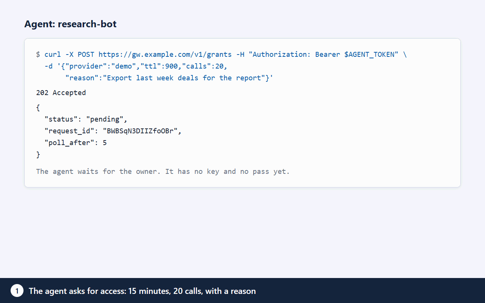

# agent-gateway

Шлюз временного доступа к API для ИИ-агентов, self-hosted. Агент получает пропуск на срок и с лимитом вызовов. Ключ API он не получает никогда.

Для кого: для тех, кто запускает ИИ-агентов (Claude Code, Cursor, Claude Desktop, ChatGPT, скрипты) на своих CRM, почте, платёжных и LLM-аккаунтах и не хочет вставлять долгоживущие ключи в каждого агента.



## Как это работает

1. Агенту нужен API, например Gemini. Он просит у шлюза доступ: срок, лимит вызовов, причина («Свести 14 обращений за сегодня»).
2. Вы получаете уведомление (Telegram, Slack или e-mail, что включено) с фактами: агент, сервис, срок, лимит, причина. Одобряете в Telegram или на сайте, по политике ключа.
3. Агент получает пропуск (`gwt_...`), а не ваш ключ.
4. Агент вызывает `/v1/proxy/gemini/...` с пропуском. Шлюз сам подставляет ключ, пересылает запрос и считает вызовы. После 20 вызовов или 10 минут пропуск перестаёт работать.

Пропуск или агента можно отозвать в любой момент, отзыв действует со следующего вызова.

## Зачем

- **Ключи не покидают сервер.** Ключи хранятся зашифрованными (AWS SSM Parameter Store или зашифрованный файл). Агенты их не читают, значения не попадают в логи и ответы.
- **Срок, квота вызовов, отзыв.** У пропуска есть срок, максимум вызовов и лимит параллельных запросов. Есть и лимит частоты на агента (`GW_PROXY_RATE_PER_MIN`).
- **Фильтр данных.** Для части сервисов владелец выбирает, какие типы данных и поля видит агент. См. раздел «Фильтр данных».
- **Журнал.** Заявки, одобрения, вызовы и попытки входа пишутся в журнал, который только дополняется.

## Быстрый старт

### VPS (Debian 12, Ubuntu 24.04)

Направьте DNS-запись A на сервер и запустите:

```bash
curl -fsSL https://raw.githubusercontent.com/maximskorohod/agent-gateway/main/scripts/setup.sh | sudo bash -s -- --domain gw.example.com --repo https://github.com/maximskorohod/agent-gateway
```

По умолчанию сейф AWS SSM, ему нужна роль инстанса. Вне AWS добавьте `--vault file`.

Скрипт ставит Node.js 22, Caddy (TLS автоматически) и сервисы systemd, затем печатает одноразовую ссылку мастера (15 минут). По ней задаются пароль владельца, 2FA и, по желанию, Telegram. Подробности, копии и восстановление: [установка на сервер](DEPLOY.md).

### Docker

```bash
cp .env.example .env          # задайте DOMAIN и GW_PUBLIC_URL
docker compose up -d
docker compose exec gateway node bin/gateway.js init   # печатает одноразовую ссылку мастера
```

Caddy получает сертификат Let's Encrypt для `DOMAIN`. Порты 80 и 443 должны быть доступны. Порт шлюза наружу не публикуется. Подробнее: [установка на сервер](DEPLOY.md).

### Локально (npm)

Нужен Node.js 22.

```bash
npm ci
GW_VAULT=file node bin/gateway.js init     # печатает одноразовую ссылку мастера
node bin/gateway.js start                  # http://127.0.0.1:8080
npm test
```

После мастера сайт открывает `/welcome` с карточками подключения агентов.

## Подключение агента

Владелец создаёт агента на сайте (раздел Agents). Токен агента (`gwa_...`) показывается один раз. Способов четыре.

| Способ | Где | Для чего |
| --- | --- | --- |
| Карточки онбординга | `/welcome` на вашем шлюзе | Готовые сниппеты для ChatGPT, Claude Code, Cursor, Claude Desktop и curl. Токен показан на карточке один раз. |
| REST API | `/v1` | Скрипты и любой HTTP-клиент. |
| MCP-сервер | `/mcp` | MCP-клиенты. Инструменты: `list_services`, `request_access`, `check_request`, `call`. |
| Скилл агента | [skills/agent-gateway](../../skills/agent-gateway/SKILL.md) | Claude Code и другие агенты со скиллами. Скрипту `gw.sh` нужны `curl` и `jq`. |

### REST

Запрос доступа. `ttl` в секундах (от 300 до 86400, не больше лимита ключа). `reason` до 200 символов, её видит владелец.

```bash
curl -s -X POST https://gw.example.com/v1/grants \
  -H "Authorization: Bearer $AGENT_TOKEN" -H "Content-Type: application/json" \
  -d '{"provider":"gemini","ttl":600,"calls":20,"reason":"Summarize the 14 support tickets from today"}'
```

- `200` `{"status":"approved","token":"gwt_...","expires_at":...,"max_calls":20}`: одобрено сразу (политика ключа разрешает).
- `202` `{"status":"pending","request_id":"...","poll_after":5}`: ждёт владельца.
- `403`: отказ по политике или нет ключа для сервиса.

Пока `pending`, опрашивайте не чаще раза в 5 секунд. Пропуск выдаётся один раз.

```bash
curl -s https://gw.example.com/v1/grants/$REQUEST_ID \
  -H "Authorization: Bearer $AGENT_TOKEN"
```

Вызов сервиса через прокси. Путь после `/v1/proxy/<сервис>/` пересылается как есть. Заголовок `Authorization` агента шлюз заменяет своим.

```bash
curl -s https://gw.example.com/v1/proxy/gemini/v1beta/models \
  -H "Authorization: Bearer $GRANT_TOKEN"
```

Ошибки прокси:

| Статус | Код | Смысл |
| --- | --- | --- |
| 401 | `invalid_grant` | Пропуск неверный, истёк или отозван. |
| 403 | `method_not_allowed`, `write_not_allowed` | Фильтр владельца закрыл метод или запись. |
| 400 | `query_not_allowed` | В запросе параметр, который закрыт фильтром. |
| 429 | `quota_exceeded`, `rate_limited` | Достигнут лимит вызовов, параллельности или частоты. |
| 502 | `upstream_unreachable` | Сервис не ответил. |
| 503 | `service_unavailable` | База или сейф недоступны. Шлюз закрывается при сбое. |

### MCP

Streamable HTTP на `/mcp`. Каждый запрос идёт с `Authorization: Bearer gwa_...` (токен агента). Пропуска остаются на сервере, модель их не видит. Браузерным MCP-клиентам нужен их origin в `GW_MCP_ORIGINS` (через запятую). Клиенты без заголовка `Origin` (CLI, десктоп) работают как есть. `GW_MCP_ENABLED=0` выключает адрес. Описание инструментов: [docs/ARCHITECTURE.md](../ARCHITECTURE.md#mcp-tool-reference) (на английском).

## Фильтр данных

Для сервисов, где он есть, владелец ограничивает то, что видит агент. Фильтр работает по ответу, поэтому действует на каждого агента с этим ключом.

- **Типы данных и поля.** Выбираются типы (например, Deals) и поля внутри них. Всё остальное вырезается из JSON-ответа до агента. Методы и маршруты вне выбранных типов дают `403`.
- **Только чтение (`readOnly`).** Проходят только чтения. У REST-сервисов это `GET` и `HEAD` плюс перечисленные маршруты поиска. У Bitrix24 и Telegram это список методов чтения. Запись даёт `403 write_not_allowed` и не тратит квоту. По умолчанию включено у CRM и поддержки (HubSpot, Pipedrive, Zendesk, Bitrix24, amoCRM).
- **Маскировка (`mask`).** Во всех строковых значениях JSON-ответа заменяет на `****` e-mail, телефоны с `+` или разделителями, номера банковских карт (проверка Luhn) и IBAN. Имена не определяются. Голая строка цифр без `+` и разделителей не маскируется: её нельзя отличить от ID или суммы.
- **Ослабление требует свежего 2FA.** Выключение `readOnly` или `mask`, добавление типа, поля или флага просит новый код TOTP. Перед применением сайт показывает страницу «было → стало».
- **REST-маршруты.** У REST-сервисов правило это HTTP-метод и маршрут, например `GET /crm/v3/objects/deals/:id`. Поиск включается отдельным флагом у типа. Пакетные операции и выгрузки остаются закрытыми.
- **Проверить на одном вызове.** На странице фильтра ключа кнопка «Проверить на одном вызове» делает один настоящий запрос чтения от имени владельца (вне лимитов агентов, с записью в журнал) и показывает только названия полей, без значений: что увидит агент и что скрыто.
- **Что знает агент.** В ответе об одобрении и в списке заявок есть объект `filter` (типы, открытые методы, `read_only`, `mask`), чтобы агент спланировал вызовы.

Фильтры есть для Bitrix24, HubSpot, Pipedrive и Zendesk. Поля HubSpot, Pipedrive и Zendesk взяты из документации сервисов и не проверены на живом аккаунте (в `providers.yaml` помечены `unverified`). После сохранения нажмите «Проверить на одном вызове».

Фильтр не мешает агенту искать по скрытому полю и по числу результатов угадывать значение. См. [SECURITY.md](../../SECURITY.md).

## Демо-режим

`GW_DEMO=1` запускает общий публичный экземпляр без реальных данных и без исходящих соединений. В нём один выдуманный сервис (Demo CRM), который отвечает мок внутри процесса, фиксированный демо-агент и кнопка «Simulate agent request». Данные сбрасываются раз в час (`GW_DEMO_RESET_SEC`). Мастер, настройки, реальные провайдеры и каналы уведомлений закрыты (404). Процесс не запустится, если в каталоге данных есть реальные данные, а вторая защита отклоняет любое исходящее соединение. Используйте отдельный пустой `GW_DATA_DIR`. Изоляция на уровне сервера для публичного демо описана в [установке на сервер](DEPLOY.md).

## Поддерживаемые сервисы

В каталоге (`providers.yaml`): OpenAI, Anthropic, Google Gemini, OpenRouter, Groq, Mistral, GitHub, Slack, Notion, Linear, Stripe, HubSpot, Pipedrive, Zendesk, Atlassian (Jira и Confluence Cloud), Airtable, Resend, SendGrid, Twilio, Deepgram, ElevenLabs, Telegram Bot API, Bitrix24 (облако и коробка), amoCRM и «Другой» (любой публичный HTTPS API, где ключ передаётся в заголовке, имя которого вы зададите).

## Настройки

Настройки задаются переменными окружения. Значения по умолчанию лежат в `src/config.js`.

| Переменная | По умолчанию | Смысл |
| --- | --- | --- |
| `GW_DATA_DIR` | `./data` | Каталог базы SQLite, файлового сейфа и мастер-ключа. |
| `GW_PORT` | `8080` | Порт. |
| `GW_HOST` | `127.0.0.1` | Адрес прослушивания. |
| `GW_PUBLIC_URL` | `http://127.0.0.1:8080` | Публичный адрес, идёт в ссылки. |
| `GW_VAULT` | `file` | Хранилище ключей: `file` или `ssm`. |
| `GW_VAULT_PREFIX` | `/gateway` | Префикс путей параметров сейфа SSM. |
| `GW_SSM_REGION` | `AWS_REGION`, затем `eu-central-1` | Регион AWS для сейфа SSM. |
| `GW_LOG_LEVEL` | `info` | Уровень логов. |
| `GW_LANG` | `en` | Язык интерфейса: `en` или `ru`. |
| `GW_TZ` | `UTC` | Часовой пояс для окон политики и дат. |
| `GW_TRUST_PROXY` | `loopback` | Доверенные адреса обратного прокси (через запятую). В Docker задайте подсеть Docker, например `172.16.0.0/12`. |
| `GW_PROXY_RATE_PER_MIN` | `300` | Вызовов прокси на агента в минуту, REST и MCP вместе. |
| `GW_MCP_ENABLED` | включено | `0`, `false` или `off` выключает адрес `/mcp`. |
| `GW_MCP_ORIGINS` | пусто | Разрешённые браузерные origin для MCP (через запятую). |
| `GW_MCP_MAX_SESSIONS_PER_AGENT` | `5` | MCP-сессий на агента. |
| `GW_MCP_MAX_SESSIONS` | `200` | MCP-сессий всего. |
| `GW_MCP_IDLE_SEC` | `900` | Через сколько простоя закрывать MCP-сессию. |
| `GW_MCP_MAX_LIFETIME_SEC` | `86400` | Максимальная жизнь MCP-сессии. |
| `GW_MCP_MAX_RESPONSE` | `65536` | Байт ответа сервиса, отдаваемых модели. |
| `GW_MCP_BODY_LIMIT` | `262144` | Максимальный размер тела MCP-запроса, байт. |
| `GW_MCP_CALL_PARALLEL` | `4` | Одновременных `call` на MCP-сессию. |
| `GW_AUTH_PROVIDER` | локальный | Модуль входа. Неизвестное имя останавливает запуск. См. [AUTH.md](../AUTH.md). |
| `GW_WAITLIST_URL` | пусто | HTTPS-ссылка в подвале страниц: лист ожидания облачной версии. Любое другое значение игнорируется. |
| `GW_DEMO` | выключено | `1`, `true` или `on` включает демо-режим. |
| `GW_DEMO_RESET_SEC` | `3600` | Период сброса демо. |
| `GW_PROD_HOSTS` | пусто | Имена хостов боевого шлюза. Страховка для демо-режима. |

## Ограничения

Шлюз сужает то, что агент может сделать с ключом. Доверие к серверу, к сервису и к каналу одобрения он не убирает. Коротко:

- Любой с root на сервере или с правами администратора в аккаунте AWS может прочитать все ключи.
- Без фильтра данных одобренный пропуск разрешает любой вызов, который разрешает ключ. Берите ключи с самыми узкими правами, какие даёт сервис.
- Сам сервис видит ключ и данные запроса.
- Агент может искать по скрытому полю и по числу результатов понять, есть ли значение.
- Маскировка без ML: имена и голые строки цифр она не находит.
- Zendesk с 27.10.2026 не выдаёт новые API-токены; существующие работают до 30.04.2027. Поддержка OAuth (client_credentials) появится после запуска.
- Код не проходил внешний аудит безопасности.

Полная модель угроз, меры защиты и как сообщить об уязвимости: [SECURITY.md](../../SECURITY.md).

## Требования

- Node.js 22 или Docker.
- 1 vCPU и 1 ГБ ОЗУ для одного владельца.
- SQLite, внешняя база не нужна.

## Статус

Версия 1.0: один владелец, self-hosted. Интерфейс по умолчанию английский, русский включается `GW_LANG=ru`. Сообщения установочного скрипта на английском. `docs/DEPLOY.md` на английском, русская версия в `docs/ru/DEPLOY.md`.

В этой версии вживую на сервере пока не проверены: одобрение через Telegram, уведомления SMTP, сейф `ssm` на AWS, Docker с настоящим сертификатом Caddy, Atlassian и Airtable. Сообщения о результатах приветствуются.

## Планы

- Команды: несколько владельцев и агентов с раздельными политиками
- Облачная версия (адреса листа ожидания пока нет)
- Вход через OAuth

## Лицензия

Apache-2.0, см. [LICENSE](../../LICENSE). Как участвовать: [CONTRIBUTING.md](../../CONTRIBUTING.md). Полная версия на английском: [README](../../README.md).
